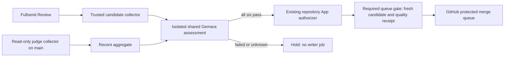

# Fullsend + Gemara auto-merge example

This experimental repository asks a practical owner question: **when may an
agent-approved PR enter my protected merge queue?** Fullsend reviews the change.
Shared Gemara policies assess the evidence. A separate repository App requests
queue enrollment; **GitHub performs the merge**.

## The six requirements

1. **Owner scope:** the PR is open, ready, within the owner's unexpired delegation,
   and changes only the allowed ordinary documentation file. Renames, executable
   files and governance changes are excluded. Change size is not a safety signal.
2. **Review clear:** authenticated Fullsend Review approved this head, supplied a
   risk assessment at or below the owner limit, and left no unresolved findings.
3. **Checks pass:** the named GitHub Actions checks passed on this exact head.
4. **Evidence current:** the collector verified the Review producer, run, attempt,
   artifact digest and current PR/target revisions.
5. **Protections active:** the protected queue and required gate remain configured,
   discussions are resolved and no active ruleset has a bypass actor.
6. **Review quality:** at least 99% of the configured judge's valid scored approvals
   passed, with sufficient and recent evidence.

All six must pass. Missing, ambiguous, stale or invalid data holds. The quality
measure is an experimental **judge pass rate among scored approvals**, not a
production accuracy guarantee or an independent verdict on this PR.

## Shared policy versus repository setup

The public [shared integration](https://github.com/ascerra/fullsend-gemara-integration)
contains the Gemara catalogs, policies, Go evaluator, metadata-only MLflow
collector and synthetic boundary tests. This repo pins its immutable revision
and source checksum.

[One consumer configuration](gemara-auto-merge/config/shared-gate.json) binds
those shared requirements to this repository's identity, allowed paths, checks,
review workflow, risk limit and owner grant. Its quality policy selects the
scorer/source and requires 100 samples, a trailing year, a snapshot no older than
15 minutes, and a latest score no older than seven days. The endpoint and reader
credentials belong in the `gemara-policy-reader` GitHub environment, restricted
to `main`; they are not tracked files. The same protected environment carries an
owner-audited ruleset version because read-only tokens cannot see bypass actors;
CI holds on any drift from that audited state.

[Walk through the implementation](docs/SHARED-MERGE-GATE.md) for the collector,
isolation and writer boundaries. These GitHub adapters and receipt checks were
created for this experiment. Gemara supplies the policy document model, native
assessment execution and evaluation logs; it does not collect forge evidence,
authenticate our receipts, isolate code or merge PRs.

## Execution and demonstrations



Setup is deployed to `main`; demonstration PRs exercise the installed behavior.
The automatic owner grant still expires **October 22, 2026 at 2 p.m. EDT** and
[maintenance remains disabled](gemara-auto-merge/config/documentation-auto-merge-settings.json).
The older custom auto-merge model agent remains disabled. This is a lab, not a
production service or an organization-wide standard.

The new six-requirement enforcement is undergoing hosted acceptance. A passing
synthetic 99/100 case is not a live merge. The authentic population must satisfy
the unchanged threshold before this policy can permit a real merge.

- [Gate workflow runs](https://github.com/fullsend-ai/auto-merge/actions/workflows/gemara-auto-merge.yml)
- [Earlier protected native-evidence baseline: PR #51](https://github.com/fullsend-ai/auto-merge/pull/51)
- [Earlier advisory shared Review replay](docs/SHARED-REVIEW.md)
- [Historical experiments and documentation](docs/README.md)

GitLab can reuse the shared policy and evaluator with its own trusted binding and
evidence adapter. Our separate GitLab example holds because risk assessment is missing. A failed GitLab pipeline alone does
not prove enforced merge prevention; this step changes only the GitHub consumer.

## Verification

```sh
python3 scripts/validate_example.py
python3 -m unittest discover -s gemara-auto-merge -p 'test*.py'
```

The hosted suite also runs the pinned combined evaluator inside the actual
UID/filesystem/network jail: clean synthetic candidates hold at 94/100 and pass
at 99/100. Artifacts contain bounded aggregates, timestamps, digests and native
assessment logs, never raw traces, judge rationale, endpoints or credentials.
